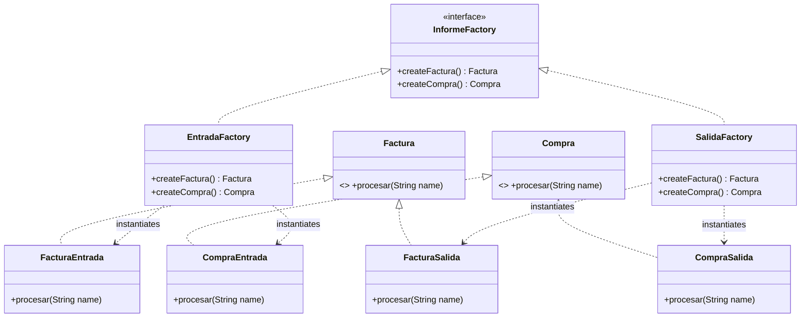

# Sistema de Procesamiento de Informes - Abstract Factory Avanzado (Java 21)

Repositorio formal para la resolución de la actividad práctica de **Patrones de Creación**, estructurado bajo el paradigma de desarrollo moderno con **Java 21 (LTS)**.

## 🚀 Arquitectura y Patrones Aplicados

El sistema implementa el patrón **Abstract Factory (Fábrica Abstracta)** para encapsular la variabilidad bidimensional del dominio (Categorías y Tipos de Informes), garantizando el aislamiento del cliente respecto a los constructores concretos y asegurando la coherencia en la creación de familias de objetos.

### Características de Alta Ingeniería Incluidas:
* **Programación Defensiva (Parse, Don't Validate):** Validación y tipado estático estricto en la frontera del sistema a través de expresiones regulares (`Pattern` inmutable) y encapsulamiento en el record `InformeId`.
* **Tipos de Datos Algebraicos (ADT):** Uso de `sealed interface` y la cláusula `permits` para cerrar jerarquías y delegar el control de exhaustividad al compilador.
* **Seguridad ante Nulos:** Implementación de firmas honestas mediante `Optional<T>` en lugar de retornos `null` tradicionales, mitigando la rigidez vertical descubierta en el Ejercicio 3.
* **Mapeo de Alta Densidad Operacional:** Registro de fábricas optimizado mediante un `EnumMap` inmutable con costo de acceso constante estricto $O(1)$ sin sobrecosto de hashing.
* **Garantía de Exhaustividad:** Flujo de despacho polimórfico estructurado mediante expresiones `switch` funcionales (Java 21), forzando el control estricto de los enumerados en tiempo de compilación.

---

## 📊 Diagramas de Arquitectura UML (Sintaxis Mermaid)

### 1. Estado Inicial del Sistema (Antes de la Evolución - Ejercicio 2)
Muestra la simetría base del sistema con las categorías funcionales iniciales de Entrada y Salida.



### 2. Estado Final del Sistema (Después de la Evolución - Ejercicio 3)
Muestra la ampliación horizontal con la familia **MIXTA** y la mutación vertical asimétrica con el producto **PEDIDO** protegido mediante `Optional`.


---

## 🛠️ Requisitos de Ejecución

* **Java Development Kit (JDK):** Versión 21 o superior de forma mandatoria.
* **Entorno:** Compatible con cualquier IDE moderno (soporte nativo para VS Code).

## 💻 Instrucciones para Ejecución en Consola

Para compilar y ejecutar el proyecto manualmente desde la terminal, ejecute los siguientes comandos:

```bash
# 1. Compilar el archivo fuente
javac SistemaInformes.java

# 2. Ejecutar la clase principal
java SistemaInformes
```

## 📊 Dataset de Prueba Evaluado
El método `main` incluye un vector de pruebas exhaustivo que valida de manera automática:
1. Flujos convencionales de Entrada y Salida (`ENT_FAC`, `SAL_COM`).
2. Robustez de la Extensión Horizontal: Categoría `MIXTA`.
3. Robustez de la Extensión Vertical y validación polimórfica: Tipo `PEDIDO`.
4. Programación defensiva ante cadenas corruptas, formatos inválidos y entradas nulas (`null`).
