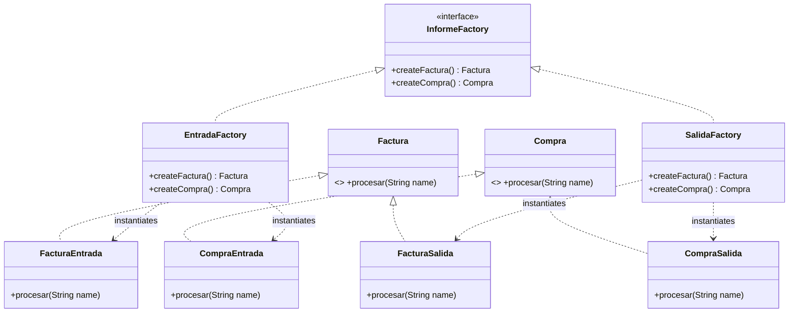
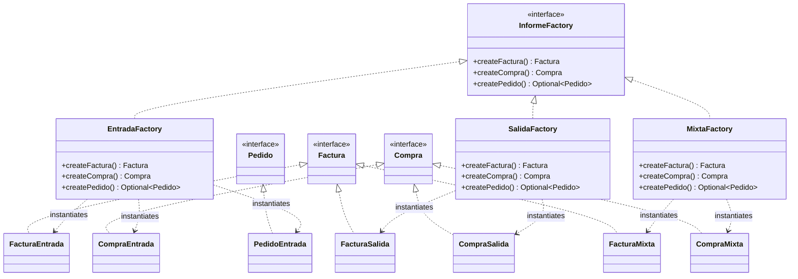

# Sistema de Procesamiento de Informes - Abstract Factory Avanzado (Java 21)

Repositorio formal con la resolución de la actividad práctica de **Patrones de Creación**, modelado y optimizado bajo estándares contemporáneos de arquitectura de software.

## 🚀 Arquitectura y Patrones Aplicados

El sistema implementa el patrón **Abstract Factory (Fábrica Abstracta)** para aislar la lógica cliente de la instanciación de familias de objetos relacionados (Categorías vs. Tipos de Informe), mitigando la obsesión por primitivos y garantizando la coherencia estructural del dominio.

### Características de Alta Ingeniería Incluidas:
* **Programación Defensiva (Parse, Don't Validate):** Validación y tipado estático estricto en la frontera del sistema a través de expresiones regulares (`Pattern` inmutable) y encapsulamiento seguro en el record `InformeId`.
* **Tipos de Datos Algebraicos (ADT):** Jerarquías cerradas mediante `sealed interface` y la cláusula `permits` para control exhaustivo en tiempo de compilación.
* **Preservación de LSP con Mónadas:** Sustitución honesta de retornos `null` mediante el uso de `Optional<T>`, gestionando la asimetría de productos de forma segura.
* **Despacho Exhaustivo:** Uso de expresiones `switch` funcionales (Java 21) que garantizan la cobertura total de variantes operacionales en la fase de compilación.

---

## 📊 Diagramas de Arquitectura UML (Sintaxis Mermaid)

### 1. Estado Inicial del Sistema (Antes de la Evolución)


### 2. Estado Final del Sistema (Después de las Evoluciones A y B)


---

## 🛠️ Requisitos e Instrucciones de Ejecución

* **Java Development Kit (JDK):** Versión 21 o superior de forma mandatoria.

Para compilar y ejecutar el ecosistema de pruebas defensivas desde la terminal, ejecute:

```bash
# Compilación de la unidad estructural
javac SistemaInformes.java

# Ejecución del motor general
java SistemaInformes
```
